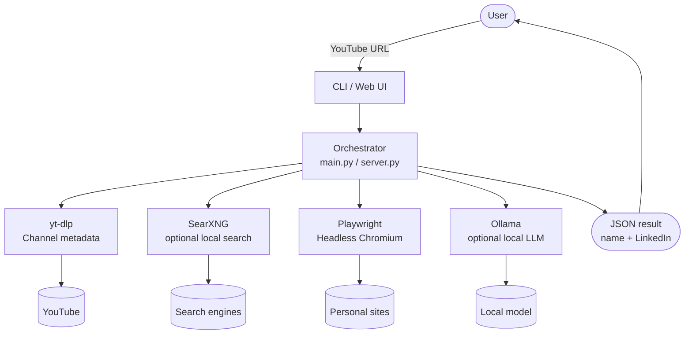
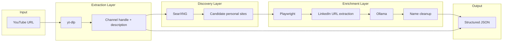
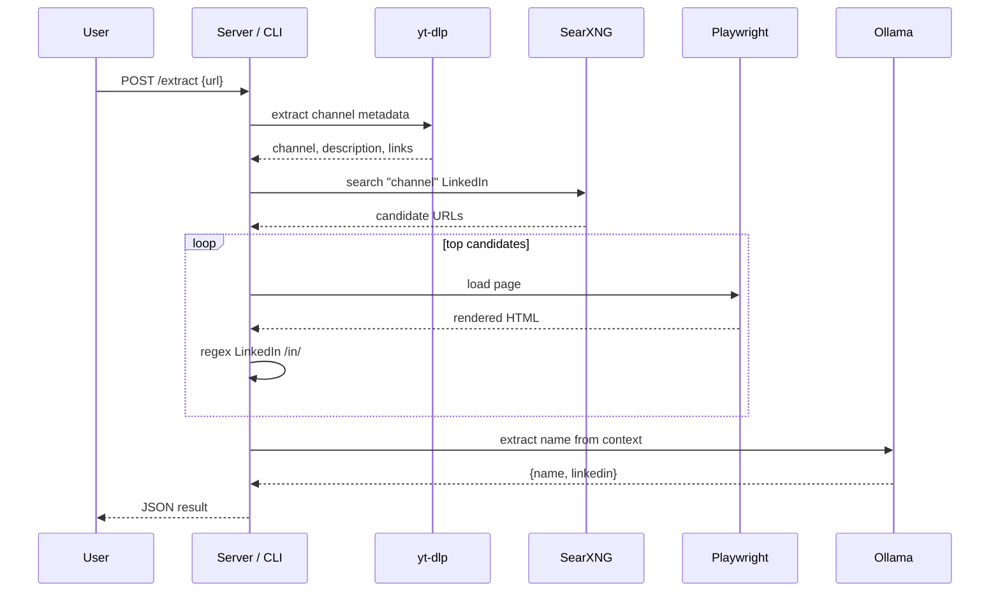
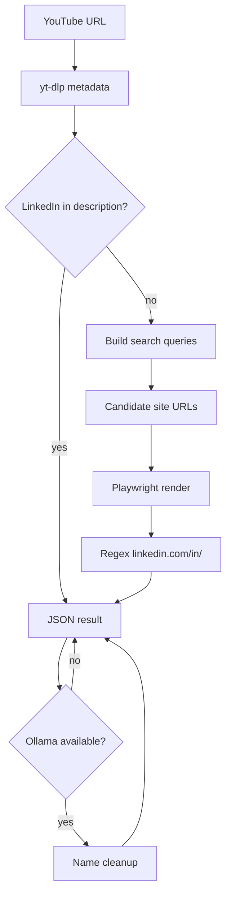

# youtube-to-linkedin

**Local-first tool** that takes a YouTube URL (video, channel, or playlist) and attempts to recover the content creator’s real name and LinkedIn (or personal profile page).

No Google APIs are required. The core pipeline runs entirely on your machine (or in a container you control).

---

## Table of Contents

- [Overview](#overview)
- [System Architecture](#system-architecture)
- [System Design](#system-design)
- [SDLC](#sdlc)
- [Component Breakdown](#component-breakdown)
- [Data Flow](#data-flow)
- [Quick Start](#quick-start)
- [Usage](#usage)
- [Deployment](#deployment)
- [Limitations](#limitations)
- [License](#license)

---

## Overview

Many creators never put their real name or LinkedIn in the YouTube channel About section. The useful signal is often one hop away: a personal site, portfolio, GoFundMe, or Linktree-style page that *does* contain the LinkedIn URL (sometimes only inside JavaScript).

This tool:

1. Extracts stable channel identity from YouTube (via `yt-dlp`).
2. Optionally searches for personal sites (via self-hosted SearXNG).
3. Renders candidate pages with Playwright to surface LinkedIn links hidden in the DOM or `onclick` handlers.
4. Optionally asks a local LLM (Ollama) to clean the extracted name.

---

## System Architecture



---

## System Design

### High-level components



### Sequence (happy path)



---

## SDLC

```mermaid
flowchart LR
    subgraph Planning
        P1[Requirements<br/>local, no paid APIs]
        P2[Architecture design]
    end

    subgraph Development
        D1[CLI prototype<br/>main.py]
        D2[Web UI + server.py]
        D3[Dockerfile]
    end

    subgraph Testing
        T1[Manual YouTube URL tests]
        T2[Playwright site checks]
        T3[JSON output validation]
    end

    subgraph Deployment
        Dep1[Local run]
        Dep2[Container / Render]
        Dep3[Public demo URL]
    end

    subgraph Maintenance
        M1[yt-dlp updates]
        M2[Selector / regex tweaks]
        M3[Optional LLM prompts]
    end

    P1 --> P2 --> D1 --> D2 --> D3 --> T1 --> T2 --> T3 --> Dep1 --> Dep2 --> Dep3 --> M1 --> M2 --> M3
    M3 -.-> D1
```



---

## Component Breakdown

| Component | Role | Required | Notes |
|-----------|------|----------|-------|
| `yt-dlp` | Extract channel handle, title, description, links | Yes | Avoids YouTube Data API |
| Playwright | Render JS-heavy personal sites | Yes (for full power) | Catches `onclick` LinkedIn links |
| SearXNG | Self-hosted metasearch | Optional | Replaces Google Custom Search |
| Ollama + model | Name / LinkedIn cleanup | Optional | e.g. `qwen2.5:7b` |
| `server.py` + `index.html` | Simple web UI | Optional | Local HTTP server on port 8000 |
| Dockerfile | Container packaging | For online deploy | Includes Chromium |

---

## Data Flow



---

## Quick Start

### Requirements

- Python 3.9+
- [yt-dlp](https://github.com/yt-dlp/yt-dlp)
- [Playwright](https://github.com/microsoft/playwright)
- Optional: [Ollama](https://github.com/ollama/ollama)
- Optional: [SearXNG](https://github.com/searxng/searxng)

### Install

```bash
git clone https://github.com/ahmaddroobi99/youtube-to-linkedin.git
cd youtube-to-linkedin
pip install -r requirements.txt
playwright install chromium
```

Optional local helpers:

```bash
ollama pull qwen2.5:7b
docker run -d -p 8888:8080 searxng/searxng
```

---

## Usage

### CLI

```bash
python main.py "https://www.youtube.com/watch?v=Ynqfo_Vxpp8"
```

### Web UI

```bash
python server.py
```

Open **http://localhost:8000**, paste a YouTube URL, and click **Extract**.

### Example output

```json
{
  "channel": "ProjectMaria",
  "uploader": "ProjectMaria",
  "possible_name": "Maria Kuprikova",
  "linkedin": "https://www.linkedin.com/in/maria-kuprikova-084b95283",
  "sources": ["projectmaria.net"]
}
```

---

## Deployment

The tool needs a container host (Playwright + Chromium). Pure serverless free tiers usually fail.

### Render.com (recommended free option)

1. Go to [render.com](https://render.com) and connect the GitHub repo.
2. New Web Service → select `youtube-to-linkedin`.
3. Render detects the `Dockerfile`.
4. Deploy.

You receive a public URL (e.g. `https://youtube-to-linkedin.onrender.com`).

### Alternatives

- **Railway** — same Dockerfile flow.
- **Fly.io** — `fly launch` then `fly deploy`.

See [DEPLOY.md](DEPLOY.md) for more detail.

**Notes**
- First build is slow (Chromium download).
- Free tiers sleep; first request after idle is slower.
- Ollama and SearXNG remain optional and local.

---

## Limitations

- Success depends on the creator having a discoverable personal site or LinkedIn mention.
- Direct LinkedIn scraping without a logged-in session is unreliable; the tool prefers extracting the URL from the creator’s own pages.
- Common channel names produce noisier search results.
- Heavy anti-bot pages may block Playwright.

---

## License

MIT
